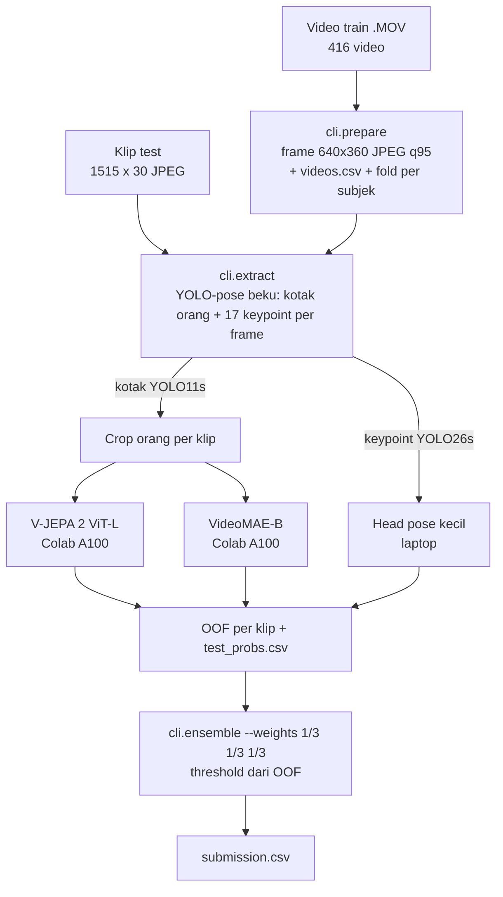
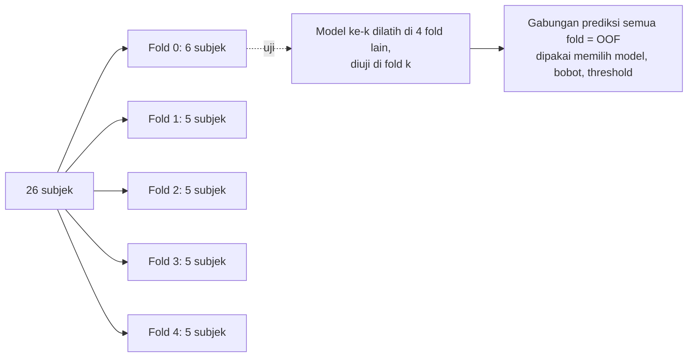
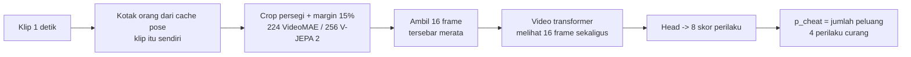
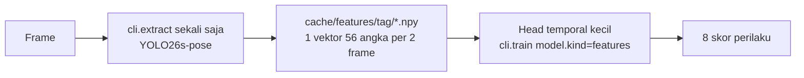

# DS2026

Input: potongan video **1 detik** (30 frame) seorang peserta ujian. Output: **0 = normal**
atau **1 = curang**. Metrik: **F1-macro** (rata-rata F1 kelas normal dan kelas curang).

## Daftar isi

- [DS2026](#ds2026)
  - [Daftar isi](#daftar-isi)
  - [1. Konsep dasar](#1-konsep-dasar)
  - [2. Data dan aturan lomba](#2-data-dan-aturan-lomba)
  - [3. Temuan EDA](#3-temuan-eda)
  - [4. Alur kerja (diagram)](#4-alur-kerja-diagram)
    - [4.1 Gambaran besar](#41-gambaran-besar)
    - [4.2 Validasi per subjek (5 fold)](#42-validasi-per-subjek-5-fold)
    - [4.3 Model video di atas crop orang](#43-model-video-di-atas-crop-orang)
    - [4.4 Head pose (fitur beku)](#44-head-pose-fitur-beku)
  - [5. Hasil sejauh ini](#5-hasil-sejauh-ini)
    - [5.1 Model yang dipakai](#51-model-yang-dipakai)
    - [5.2 Submission (public leaderboard)](#52-submission-public-leaderboard)
    - [5.3 Sudah dicoba lalu dibuang](#53-sudah-dicoba-lalu-dibuang)
    - [5.4 Pelajaran](#54-pelajaran)
  - [6. Struktur folder](#6-struktur-folder)
  - [7. Cara menjalankan](#7-cara-menjalankan)
    - [Laptop (Windows, GPU kecil): head pose + ensemble](#laptop-windows-gpu-kecil-head-pose--ensemble)
    - [Colab (A100): V-JEPA 2 + VideoMAE](#colab-a100-v-jepa-2--videomae)
  - [8. Cara mengembangkan di branch baru](#8-cara-mengembangkan-di-branch-baru)

## 1. Konsep dasar

| Istilah | Penjelasan singkat |
|---|---|
| Frame | Satu gambar diam dari video. Video 30 fps = 30 frame per detik. |
| Klip | Potongan video 1 detik (30 frame). Ini unit yang diprediksi. |
| Backbone / CNN / ViT | Jaringan saraf yang mengubah gambar menjadi vektor angka ("fitur") yang mewakili isi gambar. VideoMAE dan V-JEPA 2 = Vision Transformer (ViT) untuk video: melihat banyak frame sekaligus. |
| Pretrained | Backbone yang sudah dilatih orang lain di jutaan gambar/video (ImageNet, Kinetics). Kita tinggal menyesuaikan. |
| Fine-tune | Melatih ulang backbone pretrained dengan data kita (semua bobot, atau hanya beberapa lapisan terakhir, ikut berubah). |
| Frozen features | Backbone tidak dilatih; kita hanya mengambil fiturnya sekali, lalu melatih model kecil ("head") di atasnya. Cepat dan jalan di laptop. |
| Pose / keypoint | 17 titik tubuh (hidung, mata, bahu, siku, pergelangan, ...) hasil model YOLO-pose. Menggambarkan gerak tubuh tanpa peduli baju atau wajah. |
| Temporal transformer | Lapisan yang melihat urutan fitur antar frame, supaya model paham *gerakan*, bukan hanya satu gambar. |
| Overfitting | Model hafal data latih (misalnya wajah/baju subjek tertentu) tapi gagal di orang baru. Masalah utama lomba ini. |
| Cross-validation (CV) | Data dibagi 5 bagian ("fold"). Model dilatih di 4 bagian, diuji di 1 bagian, bergantian. |
| OOF (out-of-fold) | Prediksi tiap video oleh model yang **tidak** pernah melihatnya. Dipakai untuk menilai model secara jujur. |
| Threshold | Batas probabilitas: `p_cheat >= 0.5` -> curang. Dipilih dari OOF. |
| AUC | Seberapa baik model mengurutkan klip curang di atas klip normal (0.5 = tebak acak, 1.0 = sempurna). |
| Ensemble | Menggabungkan beberapa model (rata-rata probabilitas) supaya kesalahan saling menutupi. |

## 2. Data dan aturan lomba

- **Train**: 26 subjek x 8 perilaku x 2 kamera (depan/samping) = 416 video, masing-masing sekitar 16 detik.
- **Test**: 1515 klip 1 detik (30 JPEG 640x360), dari sekitar 6 subjek **yang tidak ada di train**.
- 8 perilaku -> label biner:

| Normal (0) | Curang (1) |
|---|---|
| Checking_Smartwatch | Using_Smartwatch |
| Looking_Around | Repeated_Peeking |
| Thinking | Looking_Under_the_Desk |
| Writing_Answers | Reading_Hidden_Notes |

Aturan penting dari FAQ panitia (wajib dipatuhi di setiap eksperimen):

| Boleh | Tidak boleh |
|---|---|
| Pretrained (timm, Hugging Face, YOLO COCO, ImageNet, Kinetics) untuk fine-tune atau ekstraksi fitur | Data eksternal |
| Frozen encoder, ensemble beda arsitektur | Prediksi zero-shot tanpa training |
| YOLO untuk bounding box tanpa fine-tune | VLM (lokal maupun API) |
| Anotasi manual data train | Pseudo-labeling, transductive inference |
| GPU cloud (Colab, Kaggle, RunPod) | **Menggabungkan prediksi antar klip test** (misalnya menyambung klip dari video yang sama), FAQ 27 |

Konsekuensinya: **setiap klip test diprediksi sendiri-sendiri**. Leaderboard: 30% public, 70% private; 3 submission per
tim per hari (reset 07:00 WIB). Notebook yang dikumpulkan adalah yang skor leaderboard-nya terbaik.

## 3. Temuan EDA

Notebook: `notebooks/01_eda.ipynb` (output dikosongkan karena frame berisi wajah peserta; jalankan ulang untuk melihat
grafik).

1. **Data seimbang sempurna**: tiap subjek punya ke-8 perilaku di kedua kamera, jadi 50% normal, 50% curang.
2. **Kamera depan = iPhone HDR** (HEVC 10-bit HLG), **kamera samping = 8-bit biasa**. Warnanya berbeda, maka dipakai
   augmentasi grayscale.
3. **Format test bukan seperti deskripsi**: 640x360 (bukan 1280x720), JPEG kualitas 95 hasil OpenCV. `cli.prepare` meniru
   persis proses ini untuk video train, supaya train dan test terlihat sama bagi model.
4. **Subjek test tidak ada di train** (jarak gambar test ke train setara jarak antar subjek berbeda). Karena itu validasi
   wajib dibagi **per subjek** (GroupKFold); kalau tidak, skor CV akan terlalu optimistis.
5. **Label per video, tapi aksinya singkat**: di video "curang", banyak detik yang terlihat seperti menulis biasa. Label
   klip jadi "berisik"; ini sumber kesulitan utama.
6. **Pasangan perilaku yang mirip**: Checking vs Using Smartwatch, Looking_Around vs Repeated_Peeking. Bedanya ada di
   detail tangan/jam dan pola gerak kepala, sehingga resolusi di sekitar badan dan informasi gerak itu penting.
7. Kamera depan dan samping merekam **bersamaan**. Ini hanya boleh dimanfaatkan saat training, tidak untuk menggabungkan
   prediksi test (FAQ 27).

## 4. Alur kerja (diagram)

### 4.1 Gambaran besar

Setelah semua eksperimen, tersisa **tiga model** yang dipakai submission terbaik. Model lain kalah dan sudah dihapus
(lihat [5.3](#53-sudah-dicoba-lalu-dibuang)).



### 4.2 Validasi per subjek (5 fold)



### 4.3 Model video di atas crop orang



- Frame penuh 640x360 membuat tangan dan jam sangat kecil. Crop di sekitar badan memperbesar detail itu sekitar 1.5x.
  Kotaknya dihitung dari klip itu sendiri, jadi tetap patuh aturan.
- **VideoMAE-B** (dilatih di Kinetics-400): semua lapisan ikut di-fine-tune.
- **V-JEPA 2 ViT-L** (dilatih untuk gerakan tangan dan benda, Something-Something v2): encoder dibekukan kecuali 2 blok
  terakhir (`model.train_blocks=2`). Yang dilatih hanya 2 blok itu, attentive pooler, dan head baru.
- Kenapa 8 perilaku, bukan langsung 0/1? Model belajar membedakan perilaku spesifik (lebih banyak informasi), lalu
  peluang curang dihitung dari jumlah peluang ke-4 perilaku curang. Loss = cross-entropy perilaku + loss biner.
- Keduanya cepat overfit, jadi dilatih **2 epoch saja** dari jadwal learning rate yang lebih panjang
  (`train.stop_epoch=2`). Epoch ke-2 adalah puncak rata-rata antar fold. Untuk V-JEPA 2 epoch 2 menang di ketiga fold;
  untuk VideoMAE hanya jelas di fold 2 (fold 0-1 hampir sama), jadi pilihan VideoMAE lebih lemah.
- Validasi dan test sama-sama menghitung versi tanpa flip dan dengan flip TTA (`oof.csv` / `oof_flip.csv`,
  `test_probs.csv` / `test_probs_flip.csv`). Versi yang dipakai dipilih dari AUC OOF, lalu dipakai apa adanya di test.

### 4.4 Head pose (fitur beku)



Fitur pose (56 angka per frame): posisi 17 keypoint relatif terhadap kotak orang, kepercayaan tiap keypoint, ukuran dan
posisi kotak. Karena relatif terhadap tubuh, fitur ini tidak terpengaruh baju, wajah, atau warna kamera, sehingga lebih
tahan terhadap subjek baru. Modelnya kecil dan cukup dilatih di laptop.

## 5. Hasil sejauh ini

Semua angka = **OOF per klip, dibagi per subjek** (`outputs/<run>/cv.json`). `F1@thr` = F1-macro pada threshold
terbaik OOF.

**Peringatan penting (bias pemilihan epoch).** Kalau tiap fold memilih epoch terbaiknya sendiri dari F1 validasi
(`train.select=f1_macro`), skor OOF jadi terlalu tinggi 0.02-0.04, karena kurva F1 per epoch naik-turun dan kita selalu
"memetik" puncak keberuntungan. Angka yang jujur didapat dengan **jumlah epoch tetap untuk semua fold**:
`--set train.select=epoch train.patience=99 train.epochs=<N>` (N = epoch dengan rata-rata antar fold tertinggi di
`fold*/history.csv`). Bandingkan model hanya dengan angka jenis ini.

### 5.1 Model yang dipakai

Fold 0-2 (16 subjek, 3978 klip yang sama untuk semua model):

| Run (config) | Ide | F1@thr | AUC |
|---|---|---|---|
| `feat_pose_y26s_fix` (`feat_pose.yaml`, laptop, 7 epoch tetap) | YOLO26s-pose beku + head | 0.627 | 0.653 |
| `videomae_b_crop` (Colab A100) | VideoMAE-B fine-tune, crop orang 224, 16 frame | 0.664 | 0.731 |
| `vjepa2_l_crop_e4` (Colab A100, 4 epoch tetap) | V-JEPA 2 ViT-L, 2 blok terakhir dilatih, crop 256 | 0.657 | 0.736 |
| `ens_vm_pose26` | VideoMAE 0.5 + pose26 0.5 (submission #3) | 0.673 | 0.740 |
| **`ens_vj_vm_pose26`** | V-JEPA 2 + VideoMAE + pose26, bobot sama 1/3 (submission #4) | **0.675** | **0.756** |

- `videomae_b_crop` masih memakai epoch terbaik per fold (agak optimistis). Dengan epoch tetap: F1 sekitar 0.656, AUC
  0.727 (epoch 2).
- Bobot ensemble sengaja sama rata (`cli.ensemble --weights`), hanya threshold yang dipilih di OOF.
- AUC per fold gabungan 3 model: 0.741 / 0.779 / 0.758 (submission #3: 0.729 / 0.738 / 0.767).
- Kurva rata-rata 3 fold per epoch: V-JEPA 2 AUC 0.717, **0.758**, 0.745, 0.740 (epoch 1-4); VideoMAE 0.698, **0.727**,
  0.714, 0.711. Dari sini resep baru `stop_epoch=2` untuk 5 fold (`notebooks/03_colab_train.ipynb`).

Seluruh 5 fold: `feat_pose_y26s_fix` F1 0.613, F1@thr 0.620, AUC 0.660.

### 5.2 Submission (public leaderboard)

| # | Submission | Public | Catatan |
|---|---|---|---|
| 1 | ConvNeXt-T + rekonstruksi struktur test | 0.656 | **Melanggar FAQ 27**, kodenya sudah dihapus; jangan dipilih sebagai final |
| 2 | ConvNeXt-T + DINOv3 + pose YOLO11s | 0.612 | Patuh aturan; model-modelnya sudah dihapus |
| 3 | `ens_vm_pose26` (VideoMAE + pose26) | 0.683 | Patuh aturan |
| 4 | `ens_vj_vm_pose26` (V-JEPA 2 + VideoMAE + pose26) | **0.7115** | Patuh aturan; **terbaik**, kandidat final |

### 5.3 Sudah dicoba lalu dibuang

Config, kode, dan hasilnya sudah dihapus. Kalau ingin mencoba lagi, lihat riwayat Git.

| Ide | Hasil | Alasan dibuang |
|---|---|---|
| ConvNeXt-T fine-tune frame penuh + temporal transformer | F1@thr 0.617, AUC 0.649 (fold 0-2) | kalah jauh dari model video; bobot 0 di ensemble |
| ConvNeXt-T + crop orang 288 | F1 0.579, AUC 0.616 | lebih buruk dari frame penuh |
| ConvNeXt-B (Colab L4) | F1 0.584 fold 0 setelah 1 epoch | tidak lebih baik dari ConvNeXt-T, 9 menit per epoch |
| DINOv3 ViT-B beku (CLS+mean / grid) + head | F1 0.564, AUC 0.595 (5 fold, epoch tetap) | paling lemah |
| Head pose YOLO11s | F1 0.600, AUC 0.650 (5 fold) | kalah dari YOLO26s (YOLO11s tetap dipakai untuk kotak crop) |
| VideoMAE pada mosaik kepala + kedua pergelangan tangan | F1@thr 0.640, AUC 0.701 | menurunkan setiap ensemble (3 model 0.756 -> 4 model 0.750) |
| Training dipandu Grad-CAM | tidak dijalankan | Grad-CAM: benar/salah tidak bergantung pada di mana model melihat |
| V-JEPA 2 8 epoch | puncak epoch 3-4 lalu overfit | diganti 4 epoch, lalu `stop_epoch=2` |
| Threshold terpisah kamera depan/samping | F1 0.6706 vs 0.6722 global (threshold dari fold lain) | tidak membantu |
| Rekonstruksi struktur test (chain, pasangan depan/samping, subjek) | public 0.656 | dilarang FAQ 27 |
| Normalisasi fitur per kelompok subjek (centering) | F1 turun | butuh pengelompokan test, dilarang |
| Training pasangan depan+samping (pair bag) | tidak selesai | dirancang untuk keputusan per pasangan yang dilarang |

### 5.4 Pelajaran

- **Model video + crop orang** melompat jauh (AUC 0.73 vs 0.65): model yang melihat gerakan 16 frame sekaligus lebih
  cocok daripada CNN per frame. Crop saja tidak cukup; ConvNeXt + crop justru turun.
- **V-JEPA 2** sendirian setara VideoMAE, tapi kesalahannya berbeda, sehingga gabungan keduanya menaikkan AUC
  0.74 -> 0.756. **Pose** kecil tapi tahan subjek baru dan tetap menambah nilai.
- Model video cepat overfit: puncak di epoch 2 (loss validasi naik setelahnya). Pakai sedikit epoch tetap.
- **Grad-CAM** (`cli.gradcam`, `outputs/gradcam_vm_f0/`): porsi perhatian di kepala + tangan sama untuk klip benar dan
  salah (0.725 vs 0.723), dan akurasi rata 0.66-0.68 di semua kuartil. Jadi model tidak salah karena "melihat tempat
  yang salah". Kesalahan paling yakin adalah potongan 1 detik dari video curang yang isinya orang sedang menulis biasa.
  Recall curang rendah (Repeated_Peeking 0.51, Using_Smartwatch 0.60, perilaku normal sekitar 0.75).
- **Label test juga per video.** Potongan normal-tampak dari video curang tetap berlabel curang di test. Jadi tugasnya
  adalah menebak label video dari potongan 1 detik mana pun. Melatih model hanya pada "detik yang benar-benar curang"
  (anotasi manual momen, multiple-instance learning) justru mengajarinya menjawab normal untuk potongan itu, sehingga
  skor test turun. Jangan dikejar.
- Kamera samping sedikit lebih mudah (AUC 0.769 vs 0.746 depan). Akurasi per subjek 0.56-0.86, jadi public leaderboard
  (sekitar 2 subjek) berisik: pilih model dari OOF jujur, bukan public.
- Bobot ensemble yang dicari di OOF ikut optimistis; pakai bobot sama rata kecuali selisihnya besar.
- Kecepatan V-JEPA 2 dibatasi GPU (mematikan hue jitter tidak mempercepat; batch 48 sudah sekitar 98 ribu token per
  langkah). Hue jitter V-JEPA 2 tetap 0 karena kurva epoch-nya diukur begitu; VideoMAE tetap 0.05 dengan alasan yang sama.
- **Flip TTA itu pisau bermata dua.** Rata-rata prediksi klip dan bayangan cerminnya mengurangi variasi, tapi kamera
  samping selalu dari sisi yang sama dan petunjuk berarah (jam di tangan kiri, arah mengintip; V-JEPA 2 dilatih di
  Something-Something v2 yang peka arah) jadi terbalik. Run lama memakai flip hanya di test, sedangkan OOF tanpa flip,
  sehingga threshold-nya tidak cocok. Rata-rata `p_cheat` V-JEPA 2 turun dari 0.564 (OOF) ke 0.455 (test), padahal
  VideoMAE tidak bergeser (0.539 -> 0.548). Sekarang setiap model video mencatat **dua versi** (polos dan `_flip`)
  di OOF dan test. Aturan yang ditetapkan sebelum melihat hasil: per model, pakai `_flip` hanya kalau AUC OOF 5 fold-nya
  lebih tinggi; kalau tidak, pakai versi polos. Ensemble menulis versi flip sebagai `outputs/<run>@flip`.

## 6. Struktur folder

```
configs/                 satu file YAML = satu eksperimen (lihat komentar di baris pertama tiap file)
  colab_vjepa2.yaml      V-JEPA 2 ViT-L + crop, 5 fold, stop_epoch 2 (Colab A100)
  colab_videomae.yaml    VideoMAE-B + crop, 5 fold, stop_epoch 2 (Colab A100)
  feat_pose.yaml         head pose YOLO26s, 7 epoch tetap (laptop); juga dipakai untuk cache kotak YOLO11s
  debug.yaml             uji cepat seluruh alur di laptop
src/
  core/config.py         dataclass config + override `--set section.key=value`
  dataset/
    labels.py            8 perilaku -> label biner
    prepare.py           indeks train, fold per subjek, cache frame gaya test (640x360 JPEG q95)
    clips.py             dataset klip (jendela acak saat train, potongan 30 frame saat val/test) + crop orang
    transforms.py        augmentasi yang sama untuk semua frame satu klip
    features.py          dataset klip di atas cache pose
  features/
    extract.py           cache pose beku (YOLO-pose) untuk head pose dan kotak crop
    pose.py              YOLO-pose -> vektor 56 angka per frame
  models/clip_classifier.py  VideoMAE, V-JEPA 2, head pose
  training/              optimizer (AdamW / Muon untuk head), loss, loop training (Accelerate), CV per subjek, EMA
  evaluation/            metrik (F1-macro, threshold, AUC), ensemble, Grad-CAM (cek ke mana VideoMAE melihat)
  inference/predict.py   rata-rata semua fold (+ flip TTA) -> test_probs.csv, submission.csv
  eda/explore.py         helper EDA
  cli/                   prepare, extract, train, predict, ensemble, gradcam
notebooks/               01 EDA, 02 uji cepat di laptop, 03 training V-JEPA 2 + VideoMAE di Colab A100
tests/                   pytest (jalankan sebelum commit)
```

Tidak ikut ke Git (lihat `.gitignore`): `data/`, `cache/`, `outputs/`, `secrets/`, bobot model, `agent_space/`.

## 7. Cara menjalankan

Semua perintah dari root repo, dengan `src` di `PYTHONPATH`.

### Laptop (Windows, GPU kecil): head pose + ensemble

```powershell
python -m venv .venv
.venv\Scripts\python -m pip install -r requirements.txt
$env:PYTHONPATH = "src"
# data lomba diekstrak ke data/ (kaggle competitions download -c data-slayer-4)
.venv\Scripts\python -m cli.prepare --config configs/feat_pose.yaml --workers 6   # sekali, ~20 menit, 5 fold
# Cache kotak orang untuk crop model video (YOLO11s) -> cache/features/yolo11s-pose_360x640_s2 (~17 menit)
.venv\Scripts\python -m cli.extract --config configs/feat_pose.yaml --set features.backbone=yolo11s-pose --workers 4
# Head pose YOLO26s (7 epoch tetap = OOF jujur)
.venv\Scripts\python -m cli.extract --config configs/feat_pose.yaml --workers 4
.venv\Scripts\python -m cli.train --config configs/feat_pose.yaml
.venv\Scripts\python -m cli.predict --config configs/feat_pose.yaml
# Ensemble run yang sudah punya oof.csv + test_probs.csv (--weights = bobot tetap, tanpa --weights = dicari).
# Tambahkan @flip pada run video yang versi flip TTA-nya lebih bagus di OOF (bandingkan cv.json vs cv_flip.json).
.venv\Scripts\python -m cli.ensemble --runs outputs/vjepa2_l_crop_s2 outputs/videomae_b_crop_s2 outputs/feat_pose_y26s_fix `
    --out outputs/ens_s2 --weights 0.3333 0.3333 0.3334
# Grad-CAM satu checkpoint VideoMAE di klip validasi fold-nya (butuh fold*/best.pt dan cache pose)
.venv\Scripts\python -m cli.gradcam --config outputs/videomae_b_crop/config.yaml --set paths.cache_dir=cache `
    --fold 0 --ckpt outputs/videomae_b_crop/fold0/best.pt --out outputs/gradcam_vm_f0 --thr 0.62
.venv\Scripts\python -m pytest -q
```

`configs/debug.yaml` (6 subjek, 3 fold, 1 epoch) hanya untuk uji cepat seluruh alur (`notebooks/02_train_local.ipynb`)
dan memakai cache sendiri `cache_debug/`, supaya pembagian fold-nya tidak menimpa `cache/videos.csv`. Hasil tiap run: `outputs/<name>/` berisi `fold*/history.csv` (metrik per epoch), `oof.csv`, `cv.json`,
`test_probs.csv`, `submission.csv`.

### Colab (A100): V-JEPA 2 + VideoMAE

1. Salin `src/`, `configs/`, `requirements.txt`, `secrets/kaggle.json` ke Drive `MyDrive/DataSlayer26/`, plus
   `cache/pose_cache.tgz` (isi `cache/features/yolo11s-pose_360x640_s2`, supaya ekstraksi kotak tidak diulang).
2. Buka `notebooks/03_colab_train.ipynb` (Runtime -> A100), jalankan semua sel. Notebook melatih lalu memprediksi
   V-JEPA 2 kemudian VideoMAE, 5 fold, sekitar 70 menit (`train.eval_last`: karena epoch sudah ditetapkan, validasi
   dan checkpoint hanya setelah epoch terakhir). Hasil di Drive `outputs/vjepa2_l_crop_s2/` dan
   `outputs/videomae_b_crop_s2/`, masing-masing dalam versi polos dan `_flip`.
3. Sesi pertama menyimpan salinan **privat** data lomba (`cache/data-slayer-4.zip`, 6.4 GB) dan cache frame
   (`cache/frames_cache.tar`, 13 GB) ke Drive. Sesi berikutnya cukup membongkar keduanya (beberapa menit, bukan 5 + 17
   menit). Folder Drive ini jangan dibagikan (FAQ 16).
4. Training berjalan sebagai **antrean di latar belakang VM** (log: Drive `outputs/colab_train.log`). Browser yang
   putus tidak menghentikannya; sel terakhir hanya membaca log, jadi setelah reconnect cukup jalankan ulang sel itu.
   Kalau **VM-nya mati**, jalankan ulang semua sel: `train.resume` melewati fold yang sudah punya `oof.csv` + `best.pt`
   di Drive, asalkan resepnya sama (beda path, jumlah worker, atau pembagian micro-batch tetap dianggap sama; beda lr
   dan sebagainya ditolak).
5. Pengaman lain: di awal fold, `oof.csv` dan `best.pt` lama dihapus; `cli.predict` menolak run yang fold-nya tidak
   berpasangan `best.pt` + `oof.csv` (misalnya upload checkpoint 1.4 GB yang belum sampai ke Drive saat VM mati);
   pembongkaran data ke folder sementara dulu, jadi sesi yang terputus otomatis mengulang.
6. Notebook menyesuaikan diri dengan GPU: micro-batch sebesar yang muat di memori (sisanya `grad_accum`) dan worker
   loader sebanyak CPU. Batch efektif tetap 48 (V-JEPA 2) / 16 (VideoMAE) di L4, A100 40 GB, maupun A100 80 GB,
   karena resep `stop_epoch=2` diukur dengan batch itu. Batch efektif yang lebih besar tidak lebih cepat (V-JEPA 2
   sudah memenuhi GPU) dan butuh pencarian ulang lr / EMA / epoch. GPU tanpa bf16 (T4) ditolak.

## 8. Cara mengembangkan di branch baru

```powershell
git checkout main
git pull
git checkout -b nama-eksperimen          # contoh: vjepa2-seed2, pose-gru
# ... ubah kode / tambah config ...
.venv\Scripts\python -m pytest -q
.venv\Scripts\ruff check src tests
git add -A
git commit -m "V-JEPA 2: second seed"
git push -u origin nama-eksperimen       # lalu buat Pull Request ke main
```

Aturan main tim:

1. **Satu eksperimen = satu config baru** di `configs/` (dengan komentar ide di baris pertama). Jangan ubah config lama
   yang hasilnya sudah tercatat.
2. **Bandingkan hanya dengan OOF jujur** (`cv.json` dari run berepoch tetap), bukan public leaderboard (public hanya
   sebagian kecil test dan berisik).
3. Setiap fungsi baru harus dipanggil dari `cli/` dan punya test di `tests/`.
4. Jangan commit data, `cache/`, `outputs/`, bobot model, atau `kaggle.json`.
5. Setiap klip test diprediksi sendiri. Jangan pakai urutan, kemiripan, atau pengelompokan klip test.
6. Gaya kode: baris maksimal 120 karakter, `ruff check` harus bersih, file tidak diakhiri baris kosong.

Checklist anti-kesalahan (diperiksa ulang 2026-11-17; jaga tetap benar di setiap eksperimen baru):

| Cek | Status | Di mana dijamin |
|---|---|---|
| Satu subjek hanya ada di satu fold, kamera depan dan samping ikut fold yang sama | OK | `dataset/prepare.py:build_index`, test `test_build_index_folds_are_subject_disjoint` |
| Fold sama persis di laptop, Kaggle, dan Colab (urutan subjek di-sort + seed 42) | OK, dicek dari OOF ketiga mesin | jangan ubah `train.seed` / `data.n_folds` antar run yang mau digabung |
| Model fold k tidak pernah melihat subjek fold k | OK | `training/engine.py:train_fold`, test `test_train_fold_ema_clip_selection` |
| Bbox crop dan fitur pose hanya dari klip itu sendiri (tidak ada statistik dari seluruh test) | OK | `features/`, `dataset/clips.py:person_box` |
| Tiap klip test diprediksi sendiri, threshold dari OOF | OK | `inference/predict.py`, test `test_train_then_predict_with_crops` |
| Prediksi tidak memakai checkpoint fold yang belum selesai | OK | `inference/predict.py`, test `test_predict_refuses_unfinished_fold` |
| OOF dan test memakai versi TTA yang sama (threshold dari OOF cocok untuk test) | OK untuk run baru | `oof*.csv` / `test_probs*.csv` berpasangan, test `test_train_then_predict_with_crops`; run lama: OOF tanpa flip, test dengan flip |
| Normalisasi input sesuai model pretrained (ImageNet mean/std untuk VideoMAE dan V-JEPA 2) | OK | dicek dengan `video_preprocessor_config.json` di Hugging Face |
| Skor OOF tidak "memetik" epoch terbaik per fold | OK untuk run baru | `colab_vjepa2.yaml`, `colab_videomae.yaml`, `feat_pose.yaml` memakai `train.select=epoch`; run lama `videomae_b_crop` belum |
| Override `--set x=no` tetap teks, `--set train.lr=3e-4` jadi angka | OK | `core/config.py:load_config`, test `test_config_overrides_and_unknown_key` |
| Resume hanya melanjutkan run dengan resep yang sama; checkpoint basi tidak terpakai | OK | `training/cv.py:pending_folds`, `inference/predict.py`, test `test_resume_skips_finished_folds_of_the_same_recipe`, `test_predict_refuses_checkpoints_without_matching_oof` |
| Bobot ensemble dan threshold dipilih di OOF yang sama | sedikit optimistis | pakai bobot sama rata kecuali selisihnya jelas |

Ide lanjutan (urut dari yang paling menjanjikan; tanda [bukti] = didukung hasil kita, [dugaan] = belum diuji):

1. [bukti] Hasil 5 fold `notebooks/03_colab_train.ipynb` -> ensemble 3 model dengan bobot sama. Setiap model test
   menjadi rata-rata 5 fold.
2. [dugaan] Seed kedua V-JEPA 2 (`SET = "name=vjepa2_l_crop_s2_seed2 train.seed=7"`): model terkuat tapi paling
   bervariasi antar fold (AUC 0.715-0.768). Biaya sekitar 35 menit A100. Fold diambil dari `videos.csv` yang dibuat
   `cli.prepare` (seed 42), jadi `train.seed` hanya mengubah inisialisasi dan augmentasi, asalkan cache tidak dibuat
   ulang dengan seed lain.
3. [dugaan] V-JEPA 2 dengan lebih banyak blok dilatih (`model.train_blocks=4`) dan `backbone_lr` lebih kecil.
4. [dugaan] Freeze lalu unfreeze (LP-FT, Kumar et al. 2022, https://arxiv.org/abs/2202.10054) untuk VideoMAE: latih
   head dulu dengan backbone beku, baru fine-tune penuh; ditambah layer-wise LR decay 0.7-0.75 seperti resep VideoMAE
   (https://arxiv.org/abs/2203.12602).
5. [dugaan] Pose: `yolo26m-pose` / `yolo26l-pose`, fitur kecepatan keypoint antar frame, head GRU/TCN.
6. [dugaan] Uji `data.hflip=0` (flip pada kamera samping menghasilkan orientasi yang tidak ada di test).