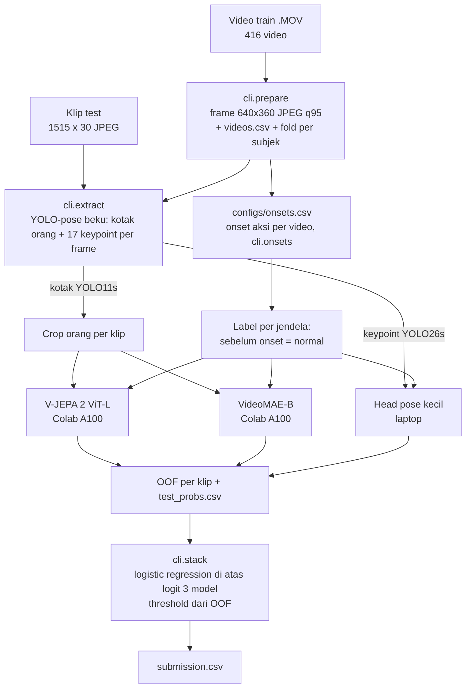
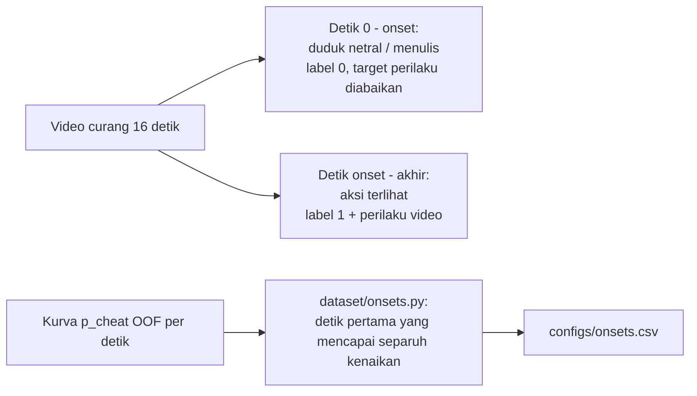
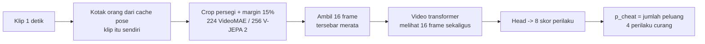
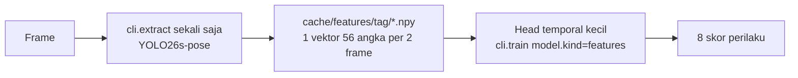

# DS2026

Input: potongan video **1 detik** (30 frame) seorang peserta ujian. Output: **0 = normal**
atau **1 = curang**. Metrik: **F1-macro** (rata-rata F1 kelas normal dan kelas curang).

Submission terbaik: **public LB 0.8764** (#7, `outputs/stack_win`): V-JEPA 2 + VideoMAE + head pose, dilatih dengan
**label per jendela** (onset aksi), lalu digabung dengan **stacking logistic regression**.

## Daftar isi

- [DS2026](#ds2026)
  - [Daftar isi](#daftar-isi)
  - [1. Konsep dasar](#1-konsep-dasar)
  - [2. Data dan aturan lomba](#2-data-dan-aturan-lomba)
  - [3. Temuan EDA](#3-temuan-eda)
  - [4. Alur kerja (diagram)](#4-alur-kerja-diagram)
    - [4.1 Gambaran besar](#41-gambaran-besar)
    - [4.2 Validasi per subjek (5 fold)](#42-validasi-per-subjek-5-fold)
    - [4.3 Label per jendela (onset aksi)](#43-label-per-jendela-onset-aksi)
    - [4.4 Model video di atas crop orang](#44-model-video-di-atas-crop-orang)
    - [4.5 Head pose (fitur beku)](#45-head-pose-fitur-beku)
    - [4.6 Stacking](#46-stacking)
  - [5. Hasil sejauh ini](#5-hasil-sejauh-ini)
    - [5.1 Cara menilai: label proksi](#51-cara-menilai-label-proksi)
    - [5.2 Model yang dipakai](#52-model-yang-dipakai)
    - [5.3 Submission (public leaderboard)](#53-submission-public-leaderboard)
    - [5.4 Sudah dicoba lalu dibuang](#54-sudah-dicoba-lalu-dibuang)
    - [5.5 Pelajaran](#55-pelajaran)
  - [6. Struktur folder](#6-struktur-folder)
  - [7. Cara menjalankan](#7-cara-menjalankan)
    - [Laptop (Windows): data, head pose, onset, stacking](#laptop-windows-data-head-pose-onset-stacking)
    - [Colab lewat CLI (WSL): V-JEPA 2 + VideoMAE](#colab-lewat-cli-wsl-v-jepa-2--videomae)
  - [8. Cara mengembangkan di branch baru](#8-cara-mengembangkan-di-branch-baru)

## 1. Konsep dasar

| Istilah | Penjelasan singkat |
|---|---|
| Frame | Satu gambar diam dari video. Video 30 fps = 30 frame per detik. |
| Klip / jendela | Potongan video 1 detik (30 frame). Ini unit yang diprediksi. |
| Backbone / ViT | Jaringan saraf yang mengubah gambar menjadi vektor angka ("fitur"). VideoMAE dan V-JEPA 2 = Vision Transformer untuk video: melihat banyak frame sekaligus. |
| Pretrained | Backbone yang sudah dilatih orang lain di jutaan video (Kinetics, Something-Something). Kita tinggal menyesuaikan. |
| Fine-tune | Melatih ulang backbone pretrained dengan data kita (semua bobot, atau hanya beberapa lapisan terakhir). |
| Frozen features | Backbone tidak dilatih; fiturnya diambil sekali, lalu model kecil ("head") dilatih di atasnya. |
| Pose / keypoint | 17 titik tubuh (hidung, mata, bahu, siku, pergelangan, ...) hasil YOLO-pose. |
| Onset | Detik ketika aksi di video mulai. Sebelum itu peserta masih duduk netral. |
| Overfitting | Model hafal data latih (wajah/baju subjek tertentu) tapi gagal di orang baru. |
| Cross-validation (CV) | Data dibagi 5 bagian ("fold"). Model dilatih di 4 bagian, diuji di 1 bagian, bergantian. |
| OOF (out-of-fold) | Prediksi tiap video oleh model yang **tidak** pernah melihatnya. Dipakai untuk menilai model secara jujur. |
| Nested CV | CV di dalam CV: langkah pemilihan (bobot, threshold) juga dipilih tanpa melihat fold yang dinilai. |
| Threshold | Batas probabilitas: `p_cheat >= thr` -> curang. Dipilih dari OOF. |
| AUC | Seberapa baik model mengurutkan klip curang di atas klip normal (0.5 = acak, 1.0 = sempurna). |
| Stacking | Model kecil (di sini logistic regression) yang belajar seberapa besar mempercayai tiap model. |

## 2. Data dan aturan lomba

- **Train**: 26 subjek x 8 perilaku x 2 kamera (depan/samping) = 416 video, masing-masing sekitar 16 detik.
- **Test**: 1515 klip 1 detik (30 JPEG 640x360), dari subjek **yang tidak ada di train**.
- 8 perilaku -> label biner:

| Normal (0) | Curang (1) |
|---|---|
| Checking_Smartwatch | Using_Smartwatch |
| Looking_Around | Repeated_Peeking |
| Thinking | Looking_Under_the_Desk |
| Writing_Answers | Reading_Hidden_Notes |

Aturan penting dari FAQ panitia (wajib dipatuhi di setiap eksperimen):

| Boleh | Tidak boleh |
|---|---|
| Pretrained (timm, Hugging Face, YOLO COCO) untuk fine-tune atau ekstraksi fitur | Data eksternal |
| Frozen encoder, ensemble beda arsitektur | Prediksi zero-shot tanpa training (FAQ 34) |
| YOLO untuk bounding box tanpa fine-tune | VLM (lokal maupun API) |
| Anotasi data train sendiri, termasuk awal aksi (FAQ 30, 40) | Memakai informasi dari test untuk melabeli train (FAQ 40) |
| Nama perilaku/kamera di nama file train sebagai label bantu (FAQ 32) | Pseudo-labeling, pretraining di frame test (FAQ 39) |
| Memproses beberapa klip sekaligus dalam satu batch (FAQ 38) | Statistik/distribusi test, transductive (FAQ 35) |
| GPU cloud (Colab, Kaggle) dan training lokal (FAQ 29) | **Menggabungkan prediksi antar klip test** (FAQ 27, 38, 39) |

**Label test (FAQ 33, 41)**: tiap klip test dilabeli menurut **perilaku yang terlihat di klip itu** (perilaku dominan
kalau hanya sebagian). Potongan menulis biasa di dalam video curang berlabel **normal**. Klip diambil dari seluruh
durasi video.

Konsekuensinya: **setiap klip test diprediksi sendiri-sendiri**. Leaderboard: 30% public, 70% private; 3 submission per
tim per hari (reset 07:00 WIB). Notebook yang dikumpulkan adalah yang menghasilkan submission final yang dipilih.

## 3. Temuan EDA

Notebook: `notebooks/01_eda.ipynb` (output dikosongkan karena frame berisi wajah peserta).

1. **Data seimbang**: tiap subjek punya ke-8 perilaku di kedua kamera, jadi 50% video normal, 50% curang.
2. **Kamera depan = iPhone HDR** (HEVC 10-bit HLG), **kamera samping = 8-bit biasa**. Warnanya berbeda, maka dipakai
   augmentasi grayscale.
3. **Format test bukan seperti deskripsi**: 640x360 (bukan 1280x720), JPEG kualitas 95 hasil OpenCV. `cli.prepare` meniru
   persis proses ini untuk video train.
4. **Subjek test tidak ada di train**. Karena itu validasi wajib dibagi **per subjek** (GroupKFold).
5. **Setiap rekaman diawali fase netral.** Rata-rata `p_cheat` OOF per detik datar di detik 0-6 untuk **semua** perilaku
   (normal maupun curang); aksinya baru mulai sekitar detik 7-9 (median 8) dan umumnya berlangsung sampai akhir.
   Ditemukan dari OOF train sendiri, bukan dari test. Dengan aturan label test di atas, fase netral video curang
   berlabel normal di test: inilah alasan label per jendela ([4.3](#43-label-per-jendela-onset-aksi)).
6. **Pasangan perilaku yang mirip**: Checking vs Using Smartwatch, Looking_Around vs Repeated_Peeking. Repeated_Peeking
   juga **terputus-putus** (menoleh beberapa detik, lalu menunduk menulis lagi).
7. Kamera depan dan samping merekam **bersamaan**. Ini hanya boleh dimanfaatkan saat training (misalnya onset kamera
   pasangannya), tidak untuk menggabungkan prediksi test (FAQ 27).

## 4. Alur kerja (diagram)

### 4.1 Gambaran besar



### 4.2 Validasi per subjek (5 fold)


### 4.3 Label per jendela (onset aksi)



- `cli.onsets` membaca OOF (satu baris per jendela) dan menulis `configs/onsets.csv` (`video_id,onset` dalam frame).
  Aturannya: baseline = rata-rata detik 0-4; onset = detik pertama (mulai detik 5) yang mencapai separuh jarak
  baseline -> puncak; dibatasi detik 6-10. Kurva lemah (kenaikan < 0.15) memakai onset kamera pasangannya, kalau tidak
  ada pakai detik 8. Video normal memakai detik 8 (hanya memengaruhi target perilaku).
  Tabel sekarang dihitung dari OOF ensemble lama berlabel video: 311 video di detik 8, sisanya detik 6-10.
- `data.onsets: configs/onsets.csv` di config mengaktifkan aturan ini (`dataset/labels.py:window_target`): jendela yang
  **titik tengahnya** sebelum onset berlabel 0 dan target perilakunya `-100` (diabaikan cross-entropy). Berlaku untuk
  training **dan** validasi, jadi OOF run baru langsung dinilai dengan label per jendela.

### 4.4 Model video di atas crop orang



- Crop di sekitar badan memperbesar tangan dan jam sekitar 1.5x. Kotaknya dihitung dari klip itu sendiri.
- **VideoMAE-B** (Kinetics-400): semua lapisan ikut di-fine-tune.
- **V-JEPA 2 ViT-L** (Something-Something v2, gerakan tangan dan benda): encoder dibekukan kecuali 2 blok terakhir.
- Loss = cross-entropy 8 perilaku + loss biner pada peluang curang. Keduanya dilatih **2 epoch** dari jadwal lr yang
  lebih panjang (`train.stop_epoch=2`, puncak rata-rata antar fold).
- Validasi dan test menghitung versi tanpa flip dan dengan flip TTA (`oof.csv` / `oof_flip.csv`). Versi yang dipakai
  dipilih dari AUC OOF (kedua model: flip menang tipis).

### 4.5 Head pose (fitur beku)



Fitur pose relatif terhadap kotak orang, jadi tidak terpengaruh baju, wajah, atau warna kamera. Modelnya kecil dan
dilatih di laptop.

### 4.6 Stacking

`cli.stack` (`evaluation/stack.py`): fitur = logit `p_cheat` tiap model untuk satu klip; logistic regression dilatih di
OOF gabungan (label per jendela), lalu dipakai apa adanya untuk tiap klip test sendiri-sendiri. Threshold = F1 terbaik
di OOF hasil stacking. Bobot yang dipelajari sekarang: V-JEPA 2 0.92, VideoMAE 0.51, pose 0.27 (intercept -0.19).

## 5. Hasil sejauh ini

### 5.1 Cara menilai: label proksi

Label test berbeda dari label video train, jadi OOF dinilai dengan **label proksi** yang meniru aturan test:
jendela video curang dianggap curang hanya mulai onset. Tiga versi: onset dari tabel (`configs/onsets.csv`), onset tetap
detik 7, dan detik 8. Run berlabel video dan berlabel jendela dibandingkan di proksi 7s/8s yang sama.

Proksi ini cocok dengan leaderboard: selalu sekitar 0.02-0.03 **di bawah** public LB, dengan urutan yang sama
(#6: proksi 0.71 -> LB 0.729; #7: proksi nested 0.849 -> LB 0.876). Jadi keputusan diambil dari proksi OOF.

### 5.2 Model yang dipakai

OOF 5 fold, 6456 klip (`outputs/<run>/cv.json`, label per jendela dari tabel onset):

| Run (config) | Ide | F1@thr | AUC |
|---|---|---|---|
| `feat_pose_y26s_win` (`feat_pose.yaml`, laptop) | YOLO26s-pose beku + head, 7 epoch | 0.734 | 0.810 |
| `videomae_b_crop_win@flip` (`colab_videomae_win.yaml`) | VideoMAE-B, crop 224, 16 frame | 0.829 | 0.915 |
| `vjepa2_l_crop_win@flip` (`colab_vjepa2_win.yaml`) | V-JEPA 2 ViT-L, 2 blok dilatih, crop 256 | 0.850 | 0.931 |
| **`stack_win`** (`cli.stack`) | stacking 3 model di atas | **0.867** | **0.939** |

`stack_win` di atas dinilai di OOF yang juga dipakai untuk melatih stacking (sedikit optimistis). Angka jujurnya dari
nested CV per fold subjek (stacking dan threshold dipilih di 4 fold, dinilai di fold ke-5), rata-rata proksi 7s/8s:

| Penggabungan | F1 nested |
|---|---|
| **Stacking LR di atas 3 logit** (dipakai) | **0.849** |
| Bobot dicari di grid | 0.847 |
| Rata-rata geometrik bobot sama | 0.834 |
| V-JEPA 2 saja | 0.827 |

Bootstrap per subjek: stacking lebih baik dari bobot sama +0.014 (interval 90% 0.004-0.025).

### 5.3 Submission (public leaderboard)

| # | Submission | Public | Catatan |
|---|---|---|---|
| 1 | ConvNeXt-T + rekonstruksi struktur test | 0.656 | **Melanggar FAQ 27**, kode sudah dihapus; jangan dipilih |
| 2 | ConvNeXt-T + DINOv3 + pose YOLO11s | 0.612 | label video |
| 3 | VideoMAE + pose26 | 0.683 | label video |
| 4 | V-JEPA 2 (4 epoch) + VideoMAE + pose26 | 0.7115 | label video, fold 0-2 |
| 5 | V-JEPA 2 saja, threshold 0.5 | 0.685 | label video |
| 6 | V-JEPA 2 + VideoMAE + pose26, 5 fold, flip | 0.7289 | label video |
| 7 | **`stack_win`**: label per jendela + stacking, thr 0.43 | **0.8764** | **terbaik**, kandidat final (`outputs/stack_win/submission_lb_0.8764.csv`) |

`cli.stack` sekarang memilih threshold 0.44 dari OOF (submission #7 memakai 0.43 dari rata-rata tiga proksi); hasilnya
hanya berbeda di 3 dari 1515 klip.

### 5.4 Sudah dicoba lalu dibuang

Config, kode, dan hasilnya sudah dihapus. Kalau ingin mencoba lagi, lihat riwayat Git.

| Ide | Hasil | Alasan dibuang |
|---|---|---|
| **Label per video** (semua jendela video curang = curang) | proksi F1 0.71, LB 0.729 (#6) | test berlabel per jendela (FAQ 33/41): fase netral dinilai acak (~0.5) |
| Hanya menaikkan threshold run berlabel video ke 0.68 | proksi F1 0.79 | dikalahkan training ulang dengan label per jendela (0.84) |
| Rata-rata geometrik bobot sama (`cli.ensemble` lama) | nested proksi 0.834 | stacking LR 0.849 |
| Rata-rata versi polos + flip | nested 0.831 | lebih buruk dari flip saja |
| Stacking LR / gradient boosting di 24 log-probabilitas perilaku | nested 0.821 / 0.829 | overfit |
| Notebook Colab di browser + Google Drive | - | diganti Colab CLI di WSL (tanpa klik, tanpa Drive) |
| ConvNeXt-T frame penuh + temporal transformer | F1@thr 0.617, AUC 0.649 (label video, fold 0-2) | kalah jauh dari model video |
| ConvNeXt-T + crop orang 288 / ConvNeXt-B | F1 0.579 / 0.584 | lebih buruk dari frame penuh |
| DINOv3 ViT-B beku + head | F1 0.564, AUC 0.595 | paling lemah |
| Head pose YOLO11s | F1 0.600, AUC 0.650 | kalah dari YOLO26s (YOLO11s tetap dipakai untuk kotak crop) |
| VideoMAE pada mosaik kepala + pergelangan tangan | F1@thr 0.640, AUC 0.701 | menurunkan ensemble |
| V-JEPA 2 8 epoch | puncak epoch 3-4 lalu overfit | diganti `stop_epoch=2` |
| Threshold terpisah kamera depan/samping | F1 0.6706 vs 0.6722 global | tidak membantu |
| Rekonstruksi struktur test / normalisasi per kelompok subjek | public 0.656 | dilarang FAQ 27/35 |

### 5.5 Pelajaran

- **Baca ulang aturan label.** Asumsi lama "label test = label video" salah (FAQ 33/41). Kurva `p_cheat` OOF per detik
  langsung memperlihatkan fase netral di awal tiap video. Melatih ulang dengan label per jendela menaikkan LB
  0.729 -> 0.876.
- **Proksi yang meniru aturan test** bisa dipercaya untuk memilih (selalu sedikit di bawah LB, urutan sama).
- **Model video + crop orang** jauh lebih kuat dari CNN per frame; **V-JEPA 2** paling kuat, VideoMAE dan pose menambah
  nilai lewat stacking.
- Model video cepat overfit: puncak di epoch 2. Jangan memilih epoch terbaik per fold (OOF jadi optimistis 0.02-0.04);
  pakai jumlah epoch tetap (`train.select=epoch`).
- Sisa kesalahan terbesar (OOF #7, 629 dari 6456 klip): Repeated_Peeking curang yang terlewat 229 (56% jendelanya),
  Using_Smartwatch 80, Reading_Hidden_Notes 70, Looking_Around dikira curang 71. Contact sheet per detik
  memperlihatkan peeking terputus-putus: detik menulis di tengahnya kemungkinan berlabel normal di test, jadi sebagian
  "kesalahan" ini sebenarnya label train kita yang masih kasar.
- **Flip TTA**: kamera samping selalu dari sisi yang sama dan petunjuk berarah (jam di tangan kiri, arah mengintip)
  terbalik saat di-flip. Karena itu OOF dan test selalu dicatat dalam dua versi, dan versinya dipilih dari AUC OOF.
- Public leaderboard teratas berisi skor 1.000 dan 0.95+ yang kemungkinan besar memakai struktur test (dilarang);
  notebook finalis diperiksa dan dijalankan ulang panitia.

## 6. Struktur folder

```
configs/                 satu file YAML = satu eksperimen (lihat komentar di baris pertama tiap file)
  colab_vjepa2_win.yaml  V-JEPA 2 ViT-L + crop, label per jendela, 5 fold, stop_epoch 2 (Colab A100)
  colab_videomae_win.yaml VideoMAE-B + crop, label per jendela, 5 fold, stop_epoch 2 (Colab A100)
  feat_pose.yaml         head pose YOLO26s, label per jendela, 7 epoch (laptop); juga untuk cache kotak YOLO11s
  onsets.csv             onset aksi per video (frame), dibuat cli.onsets
  debug.yaml             uji cepat seluruh alur di laptop
colab/                   job Colab lewat CLI resmi Google (dijalankan dari WSL)
  run_job.sh             buat VM, upload, setup, training, unduh hasil, matikan VM
  vm_setup.py            di VM: kode, data dari Kaggle API, cache frame dan kotak
  vm_start.py            di VM: antrean train + predict di latar belakang
  vm_follow.py           di VM: tampilkan progres sampai antrean selesai, bungkus hasil
  login.sh               login Google sekali untuk CLI Colab
src/
  core/config.py         dataclass config + override `--set section.key=value`
  dataset/
    labels.py            8 perilaku -> label biner, label per jendela (window_target)
    onsets.py            onset aksi per video dari kurva OOF
    prepare.py           indeks train, fold per subjek, cache frame gaya test (640x360 JPEG q95)
    clips.py             dataset klip (jendela acak saat train, potongan 30 frame saat val/test) + crop orang
    transforms.py        augmentasi yang sama untuk semua frame satu klip
    features.py          dataset klip di atas cache pose
  features/              cache pose beku (YOLO-pose) untuk head pose dan kotak crop
  models/clip_classifier.py  VideoMAE, V-JEPA 2, head pose
  training/              optimizer, loss (perilaku diabaikan sebelum onset), loop training, CV per subjek, EMA
  evaluation/            metrik (F1-macro, threshold, AUC), stacking, Grad-CAM
  inference/predict.py   rata-rata semua fold (+ flip TTA) -> test_probs.csv, submission.csv
  eda/explore.py         helper EDA
  cli/                   prepare, extract, onsets, train, predict, stack, gradcam
notebooks/               01 EDA, 02 uji cepat di laptop
tests/                   pytest (jalankan sebelum commit)
```

Tidak ikut ke Git (lihat `.gitignore`): `data/`, `cache/`, `outputs/`, `secrets/`, bobot model, `agent_space/`.

## 7. Cara menjalankan

Semua perintah dari root repo, dengan `src` di `PYTHONPATH`.

### Laptop (Windows): data, head pose, onset, stacking

```powershell
python -m venv .venv
.venv\Scripts\python -m pip install -r requirements.txt
$env:PYTHONPATH = "src"
# data lomba diekstrak ke data/ (kaggle competitions download -c data-slayer-4)
.venv\Scripts\python -m cli.prepare --config configs/feat_pose.yaml --workers 6   # sekali, ~20 menit, 5 fold
# Cache kotak orang untuk crop model video (YOLO11s) -> cache/features/yolo11s-pose_360x640_s2 (~17 menit),
# lalu bungkus untuk Colab: tar -czf cache/pose_cache.tgz -C cache/features yolo11s-pose_360x640_s2
.venv\Scripts\python -m cli.extract --config configs/feat_pose.yaml --set features.backbone=yolo11s-pose --workers 4
# Head pose YOLO26s, label per jendela
.venv\Scripts\python -m cli.extract --config configs/feat_pose.yaml --workers 4
.venv\Scripts\python -m cli.train --config configs/feat_pose.yaml
.venv\Scripts\python -m cli.predict --config configs/feat_pose.yaml
# Onset per video dari OOF (satu baris per jendela) model yang sudah ada -> configs/onsets.csv
.venv\Scripts\python -m cli.onsets --oof outputs/stack_win/oof.csv --out configs/onsets.csv
# Stacking run yang sudah punya oof.csv + test_probs.csv (@flip = versi flip TTA)
.venv\Scripts\python -m cli.stack --runs outputs/vjepa2_l_crop_win@flip outputs/videomae_b_crop_win@flip `
    outputs/feat_pose_y26s_win --out outputs/stack_win
.venv\Scripts\python -m pytest -q
```

Mengganti `configs/onsets.csv` berarti resep baru: buat config dengan nama run baru (aturan tim no. 1).
`configs/debug.yaml` (6 subjek, 3 fold, 1 epoch) hanya untuk uji cepat (`notebooks/02_train_local.ipynb`) dan memakai
cache sendiri `cache_debug/`. Hasil tiap run: `outputs/<name>/` berisi `fold*/history.csv`, `oof.csv`, `cv.json`,
`test_probs.csv`, `submission.csv`.

### Colab lewat CLI (WSL): V-JEPA 2 + VideoMAE

Memakai [Google Colab CLI](https://github.com/googlecolab/google-colab-cli) resmi. CLI ini hanya mendukung Linux, jadi
di Windows dijalankan dari WSL. Tidak perlu membuka browser, tidak perlu Google Drive: VM mengunduh data sendiri lewat
Kaggle API.

Persiapan sekali (PowerShell admin untuk langkah 1, sisanya di WSL):

```bash
wsl --install -d Ubuntu-24.04                       # lalu restart Windows
curl -LsSf https://astral.sh/uv/install.sh | sh      # di dalam Ubuntu
~/.local/bin/uv tool install google-colab-cli        # perintah: colab
# Google Cloud CLI (gcloud) dari https://cloud.google.com/sdk/docs/install#deb, lalu login sekali:
bash /mnt/d/DataSlayer26/colab/login.sh               # buka link, izinkan, tempel kode -> "LOGIN OK"
```

Menjalankan (perlu `cache/pose_cache.tgz` dan `secrets/kaggle.json` di laptop):

```bash
wsl -d Ubuntu-24.04 -- bash /mnt/d/DataSlayer26/colab/run_job.sh --ckpt \
    configs/colab_vjepa2_win.yaml configs/colab_videomae_win.yaml
```

- `run_job.sh` membuat sesi `ds` (A100, kalau penuh L4), meng-upload kode, kotak YOLO11s, dan `kaggle.json`, lalu
  menjalankan `vm_setup.py` (data + cache frame, ~18 menit), `vm_start.py`, dan `vm_follow.py` (~58 menit untuk dua
  model di A100). Hasil langsung diekstrak ke `outputs/<run>/`; dengan `--ckpt` juga `fold*/best.pt` (~9 GB, dibutuhkan
  notebook final untuk prediksi ulang). VM dimatikan di akhir. Log: `~/colab_runs/<waktu>/runner.log` di WSL.
- Selalu pakai `colab --auth=adc ...`. Cek sesi: `colab --auth=adc sessions`; matikan manual: `colab --auth=adc stop -s ds`.
  VM yang menganggur tetap memakan compute unit (`colab --auth=adc usage`).
- Koneksi yang putus diulang otomatis (ketiga langkah aman diulang). Antrean training jalan terlepas dari kernel.
- `vm_start.py` menyesuaikan diri dengan GPU: micro-batch sebesar yang muat (sisanya `grad_accum`), worker sebanyak CPU.
  Batch efektif tetap 48 (V-JEPA 2) / 16 (VideoMAE) di L4 maupun A100. GPU tanpa bf16 (T4) tidak bisa.

## 8. Cara mengembangkan di branch baru

```powershell
git checkout main
git pull
git checkout -b nama-eksperimen          # contoh: vjepa2-seed2, onsets-v2
# ... ubah kode / tambah config ...
.venv\Scripts\python -m pytest -q
.venv\Scripts\ruff check src tests colab
git add -A
git commit -m "V-JEPA 2: second seed"
git push -u origin nama-eksperimen       # lalu buat Pull Request ke main
```

Aturan main tim:

1. **Satu eksperimen = satu config baru** di `configs/` (dengan komentar ide di baris pertama). Jangan ubah config lama
   yang hasilnya sudah tercatat.
2. **Bandingkan hanya dengan OOF jujur** (label proksi, epoch tetap, nested CV untuk langkah pemilihan), bukan public
   leaderboard.
3. Setiap fungsi baru harus dipanggil dari `cli/` dan punya test di `tests/`.
4. Jangan commit data, `cache/`, `outputs/`, bobot model, atau `kaggle.json`.
5. Setiap klip test diprediksi sendiri. Jangan pakai urutan, kemiripan, atau pengelompokan klip test.
6. Gaya kode: baris maksimal 120 karakter, `ruff check` harus bersih, file tidak diakhiri baris kosong.

Checklist anti-kesalahan (diperiksa ulang 2026-11-18):

| Cek | Status | Di mana dijamin |
|---|---|---|
| Satu subjek hanya ada di satu fold, kamera depan dan samping ikut fold yang sama | OK | `dataset/prepare.py:build_index`, test `test_build_index_folds_are_subject_disjoint` |
| Fold sama di laptop dan Colab (urutan subjek di-sort + seed 42) | OK | jangan ubah `train.seed` / `data.n_folds` antar run yang mau digabung |
| Model fold k tidak pernah melihat subjek fold k | OK | `training/engine.py:train_fold`, test `test_train_fold_ema_clip_selection` |
| Onset hanya dari data train (OOF), tidak dari test | OK | `dataset/onsets.py`, `cli.onsets`; test `test_estimate_onsets` |
| Label per jendela sama di training dan validasi; video tanpa onset ditolak | OK | `dataset/labels.py:window_target`, `training/cv.py:load_videos`, test `test_window_labels_before_onset` |
| Jendela tanpa target perilaku tidak merusak loss | OK | `training/losses.py`, test `test_clip_loss_skips_missing_behavior` |
| Bbox crop dan fitur pose hanya dari klip itu sendiri | OK | `features/`, `dataset/clips.py:person_box` |
| Tiap klip test diprediksi sendiri, stacking dan threshold dari OOF | OK | `inference/predict.py`, `evaluation/stack.py`, test `test_stack_trusts_informative_run` |
| Prediksi tidak memakai checkpoint fold yang belum selesai | OK | `inference/predict.py`, test `test_predict_refuses_unfinished_fold` |
| OOF dan test memakai versi TTA yang sama | OK | `oof*.csv` / `test_probs*.csv` berpasangan, test `test_train_then_predict_with_crops` |
| Skor OOF tidak "memetik" epoch terbaik per fold | OK | semua config memakai `train.select=epoch` |
| Resep run yang dilanjutkan sama; checkpoint basi tidak terpakai | OK | `training/cv.py:pending_folds`, test `test_resume_skips_finished_folds_of_the_same_recipe` |
| Stacking dinilai jujur | OK | nested CV per fold subjek (5.2); OOF `stack_win/cv.json` sendiri sedikit optimistis |

Ide lanjutan (urut dari yang paling menjanjikan; [bukti] = didukung hasil kita, [dugaan] = belum diuji):

1. [bukti] **Anotasi per detik untuk perilaku yang terputus-putus** (Repeated_Peeking dulu, lalu Reading_Hidden_Notes
   dan Using_Smartwatch yang memudar setelah sekitar detik 12) dari contact sheet 1 frame per detik; simpan CSV dan
   gambarnya supaya prosesnya bisa diperiksa panitia (FAQ 30, 40).
2. [bukti] Onset putaran kedua dari OOF model berlabel jendela (kurvanya jauh lebih tajam), lalu training ulang.
3. [dugaan] Seed kedua V-JEPA 2 (model terkuat), digabung lewat stacking.
4. [dugaan] V-JEPA 2 dengan lebih banyak blok dilatih (`model.train_blocks=4`) dan `backbone_lr` lebih kecil.
5. [dugaan] Pose: `yolo26m-pose`, fitur kecepatan keypoint, head GRU/TCN; fitur arah kepala untuk peeking.