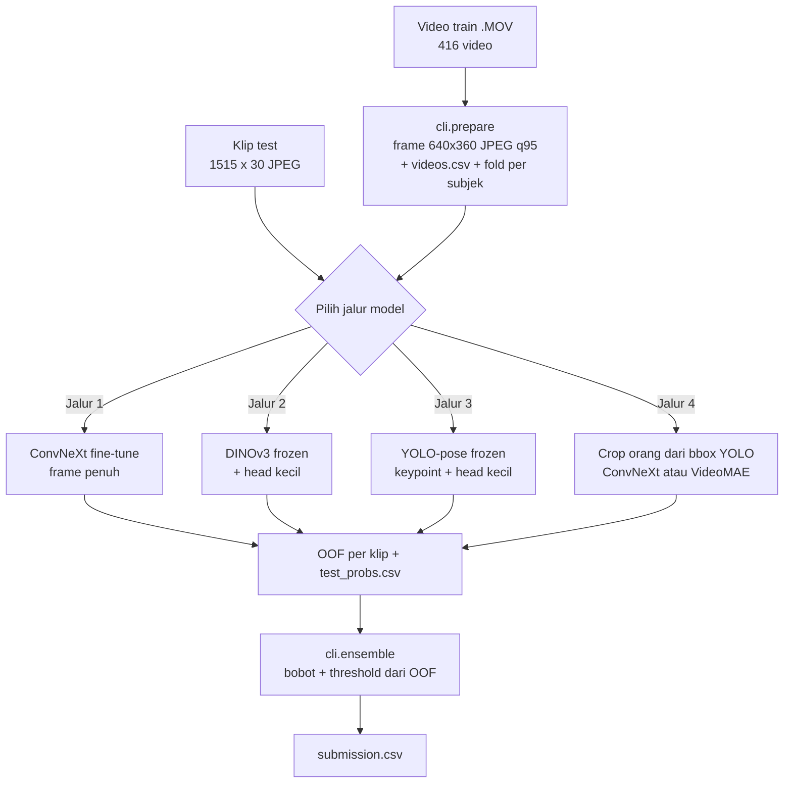
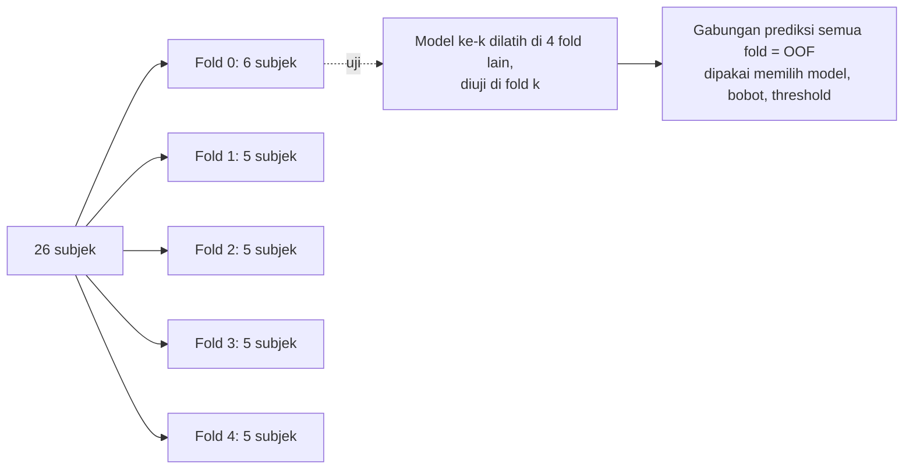
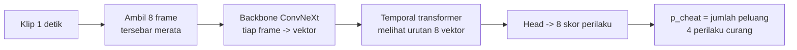
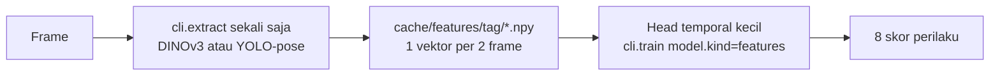
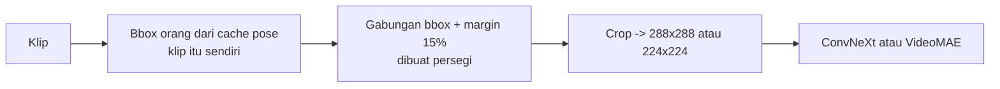

# Data Slayer 4.0 - Deteksi Kecurangan Ujian dari Video

Kompetisi Kaggle `data-slayer-4`. Input: potongan video **1 detik** (30 frame) seorang peserta ujian. Output: **0 = normal**
atau **1 = curang**. Metrik: **F1-macro** (rata-rata F1 kelas normal dan kelas curang).

README ini ditulis supaya orang yang baru belajar computer vision bisa mengikuti: baca berurutan dari atas.

## Daftar isi

1. [Konsep dasar untuk pemula](#1-konsep-dasar-untuk-pemula)
2. [Data dan aturan lomba](#2-data-dan-aturan-lomba)
3. [Temuan EDA](#3-temuan-eda)
4. [Alur kerja (diagram)](#4-alur-kerja-diagram)
5. [Hasil sejauh ini](#5-hasil-sejauh-ini)
6. [Struktur folder](#6-struktur-folder)
7. [Cara menjalankan](#7-cara-menjalankan)
8. [Cara mengembangkan di branch baru](#8-cara-mengembangkan-di-branch-baru)

## 1. Konsep dasar untuk pemula

| Istilah | Penjelasan singkat |
|---|---|
| Frame | Satu gambar diam dari video. Video 30 fps = 30 frame per detik. |
| Klip | Potongan video 1 detik (30 frame). Ini unit yang diprediksi. |
| Backbone / CNN / ViT | Jaringan saraf yang mengubah gambar menjadi vektor angka ("fitur") yang mewakili isi gambar. ConvNeXt = CNN, DINOv3 / VideoMAE = Vision Transformer (ViT). |
| Pretrained | Backbone yang sudah dilatih orang lain di jutaan gambar/video (ImageNet, Kinetics). Kita tinggal menyesuaikan. |
| Fine-tune | Melatih ulang backbone pretrained dengan data kita (semua bobot ikut berubah). |
| Frozen features | Backbone tidak dilatih; kita hanya mengambil fiturnya sekali, lalu melatih model kecil ("head") di atasnya. Cepat dan jalan di laptop. |
| Pose / keypoint | 17 titik tubuh (hidung, mata, bahu, siku, pergelangan, ...) hasil model YOLO-pose. Menggambarkan gerak tubuh tanpa peduli baju atau wajah. |
| Temporal transformer | Lapisan yang melihat urutan fitur antar frame, supaya model paham *gerakan*, bukan hanya satu gambar. |
| Overfitting | Model hafal data latih (misalnya wajah/baju subjek tertentu) tapi gagal di orang baru. Masalah utama lomba ini. |
| Cross-validation (CV) | Data dibagi 5 bagian ("fold"). Model dilatih di 4 bagian, diuji di 1 bagian, bergantian. |
| OOF (out-of-fold) | Prediksi tiap video oleh model yang **tidak** pernah melihatnya. Dipakai untuk menilai model secara jujur. |
| Threshold | Batas probabilitas: `p_cheat >= 0.5` -> curang. Dipilih dari OOF. |
| AUC | Seberapa baik model mengurutkan klip curang di atas klip normal (0.5 = tebak acak, 1.0 = sempurna). |
| Ensemble | Menggabungkan beberapa model (rata-rata probabilitas) supaya kesalahan saling menutupi. |

## 2. Data dan aturan lomba

- **Train**: 26 subjek x 8 perilaku x 2 kamera (depan/samping) = 416 video, masing-masing sekitar 16 detik.
- **Test**: 1515 klip 1 detik (30 JPEG 640x360), dari sekitar 6 subjek **yang tidak ada di train**.
- 8 perilaku -> label biner:

| Normal (0) | Curang (1) |
|---|---|
| Checking_Smartwatch | Using_Smartwatch |
| Looking_Around | Repeated_Peeking |
| Thinking | Looking_Under_the_Desk |
| Writing_Answers | Reading_Hidden_Notes |

Aturan penting dari FAQ panitia (wajib dipatuhi di setiap eksperimen):

| Boleh | Tidak boleh |
|---|---|
| Pretrained (timm, Hugging Face, YOLO COCO, ImageNet, Kinetics) untuk fine-tune atau ekstraksi fitur | Data eksternal |
| Frozen encoder, ensemble beda arsitektur | Prediksi zero-shot tanpa training |
| YOLO untuk bounding box tanpa fine-tune | VLM (lokal maupun API) |
| Anotasi manual data train | Pseudo-labeling, transductive inference |
| GPU cloud (Colab, Kaggle, RunPod) | **Menggabungkan prediksi antar klip test** (misalnya menyambung klip dari video yang sama), FAQ 27 |

Konsekuensinya: **setiap klip test diprediksi sendiri-sendiri**. Leaderboard: 30% public, 70% private; 3 submission per
tim per hari (reset 07:00 WIB). Notebook yang dikumpulkan adalah yang skor leaderboard-nya terbaik.

## 3. Temuan EDA

Notebook: `notebooks/01_eda.ipynb` (output dikosongkan karena frame berisi wajah peserta; jalankan ulang untuk melihat
grafik).

1. **Data seimbang sempurna**: tiap subjek punya ke-8 perilaku di kedua kamera, jadi 50% normal, 50% curang.
2. **Kamera depan = iPhone HDR** (HEVC 10-bit HLG), **kamera samping = 8-bit biasa**. Warnanya berbeda, maka dipakai
   augmentasi grayscale.
3. **Format test bukan seperti deskripsi**: 640x360 (bukan 1280x720), JPEG kualitas 95 hasil OpenCV. `cli.prepare` meniru
   persis proses ini untuk video train, supaya train dan test terlihat sama bagi model.
4. **Subjek test tidak ada di train** (jarak gambar test ke train setara jarak antar subjek berbeda). Karena itu validasi
   wajib dibagi **per subjek** (GroupKFold); kalau tidak, skor CV akan terlalu optimistis.
5. **Label per video, tapi aksinya singkat**: di video "curang", banyak detik yang terlihat seperti menulis biasa. Label
   klip jadi "berisik"; ini sumber kesulitan utama.
6. **Pasangan perilaku yang mirip**: Checking vs Using Smartwatch, Looking_Around vs Repeated_Peeking. Bedanya ada di
   detail tangan/jam dan pola gerak kepala, sehingga resolusi di sekitar badan dan informasi gerak itu penting.
7. Kamera depan dan samping merekam **bersamaan**. Ini hanya boleh dimanfaatkan saat training, tidak untuk menggabungkan
   prediksi test (FAQ 27).

## 4. Alur kerja (diagram)

### 4.1 Gambaran besar



### 4.2 Validasi per subjek (5 fold)



### 4.3 Isi satu model klip (Jalur 1)



Kenapa 8 perilaku, bukan langsung 0/1? Model belajar membedakan perilaku spesifik (lebih banyak informasi), lalu peluang
curang dihitung dari jumlah peluang ke-4 perilaku curang. Loss = cross-entropy perilaku + loss biner.

### 4.4 Jalur fitur beku (Jalur 2 dan 3)



Fitur pose (56 angka per frame): posisi 17 keypoint relatif terhadap kotak orang, kepercayaan tiap keypoint, ukuran dan
posisi kotak. Karena relatif terhadap tubuh, fitur ini tidak terpengaruh baju, wajah, atau warna kamera, sehingga lebih
tahan terhadap subjek baru.

### 4.5 Crop orang (Jalur 4)



Frame penuh 640x360 diperkecil ke 384x224, sehingga tangan dan jam jadi sangat kecil. Crop di sekitar badan memperbesar
detail itu sekitar 1.5x. Crop dihitung dari klip itu sendiri, jadi tetap patuh aturan.

## 5. Hasil sejauh ini

Semua angka = **OOF per klip, 5 fold per subjek** (`outputs/<run>/cv.json`). `F1@thr` = F1 pada threshold terbaik OOF.

| Run (config) | Ide | F1 | F1@thr | AUC |
|---|---|---|---|---|
| `convnext_t_t8` (`base.yaml`, Kaggle) | ConvNeXt-T fine-tune, frame penuh | 0.611 | 0.611 | 0.637 |
| `feat_dinov3_vitb` (`feat_dinov3_b.yaml`) | DINOv3 beku + head | 0.592 | 0.592 | 0.611 |
| `feat_grid_reg` (`feat_dinov3_reg.yaml` + `features.pool=grid`) | DINOv3 grid 2x4, regularisasi kuat | 0.617 | 0.617 | 0.626 |
| `feat_cls_reg` (`feat_dinov3_reg.yaml`) | DINOv3 CLS+mean, regularisasi kuat | 0.595 | 0.595 | 0.622 |
| `feat_pose_y11s` (`feat_pose.yaml`) | YOLO11s-pose beku + head | 0.633 | 0.638 | 0.669 |
| `feat_pose_y26s` (`feat_pose.yaml` + `features.backbone=yolo26s-pose`) | YOLO26s-pose beku + head | **0.643** | 0.643 | 0.680 |
| `ens_base_cls_pose` | ConvNeXt 0.3 + DINOv3-cls 0.5 + pose11 0.2 | 0.641 | 0.641 | 0.673 |
| `ens_base_cls_pose2` | DINOv3-cls 0.2 + pose11 0.5 + pose26 0.3 | **0.648** | **0.650** | **0.692** |

Submission (public leaderboard):

| Submission | Public | Catatan |
|---|---|---|
| ConvNeXt-T + rekonstruksi struktur test | 0.656 | **Melanggar FAQ 27**, kodenya sudah dihapus; jangan dipilih sebagai final |
| `ens_base_cls_pose` | 0.612 | Patuh aturan |

Pelajaran:

- **Pose menang** walaupun modelnya kecil: tidak bisa "menghafal" penampilan subjek, sehingga lebih umum ke subjek baru.
  YOLO26s sedikit lebih baik dari YOLO11s, dan keduanya saling melengkapi di ensemble.
- Model besar di frame penuh cepat overfit (ConvNeXt-T terbaik di epoch 2-7; ConvNeXt-B tidak lebih baik setelah 1 epoch
  dan dihentikan).
- Menormalkan fitur per kelompok subjek di test (centering) dan memanfaatkan urutan klip test **tidak diizinkan**; dicoba
  lalu dihapus.
- Bobot ensemble dipilih dari OOF yang sama, jadi skornya sedikit optimistis; selisih di bawah ~0.01 belum tentu nyata.

Sedang berjalan saat README ini ditulis: ConvNeXt-T + crop orang (`kaggle_t_crop.yaml`, Kaggle) dan VideoMAE + crop
(`colab_videomae.yaml`, Colab A100).

## 6. Struktur folder

```
configs/                 satu file YAML = satu eksperimen (lihat komentar di baris pertama tiap file)
src/
  core/config.py         dataclass config + override `--set section.key=value`
  dataset/
    labels.py            8 perilaku -> label biner
    prepare.py           indeks train, fold per subjek, cache frame gaya test (640x360 JPEG q95)
    clips.py             dataset klip (jendela acak saat train, potongan 30 frame saat val/test) + crop orang
    transforms.py        augmentasi yang sama untuk semua frame satu klip
    features.py          dataset klip di atas cache fitur beku
  features/
    extract.py           cache fitur beku: DINOv3 (CLS + grid patch) atau YOLO-pose
    pose.py              YOLO-pose -> vektor 56 angka per frame
  models/clip_classifier.py  ConvNeXt + temporal transformer, VideoMAE, head fitur beku
  training/              optimizer (AdamW / Muon), loss, loop training (Accelerate), CV per subjek, EMA
  evaluation/            metrik (F1-macro, threshold, AUC) dan ensemble
  inference/predict.py   rata-rata semua fold (+ flip TTA) -> test_probs.csv, submission.csv
  eda/explore.py         helper EDA
  cli/                   prepare, extract, train, predict, ensemble
notebooks/               01 EDA, 02 laptop, 03 Kaggle 2xT4, 04 Colab ConvNeXt, 05 Colab VideoMAE
tests/                   pytest (jalankan sebelum commit)
```

Tidak ikut ke Git (lihat `.gitignore`): `data/`, `cache/`, `outputs/`, `secrets/`, bobot model, `agent_space/`.

## 7. Cara menjalankan

Semua perintah dari root repo, dengan `src` di `PYTHONPATH`.

### Laptop (Windows, GPU kecil)

```powershell
python -m venv .venv
.venv\Scripts\python -m pip install -r requirements.txt
$env:PYTHONPATH = "src"
# data lomba diekstrak ke data/ (kaggle competitions download -c data-slayer-4)
.venv\Scripts\python -m cli.prepare --config configs/laptop.yaml --workers 6      # sekali, ~20 menit
# Jalur 3 (pose, model terbaik saat ini)
.venv\Scripts\python -m cli.extract --config configs/feat_pose.yaml --workers 4   # ~17 menit
.venv\Scripts\python -m cli.train --config configs/feat_pose.yaml
.venv\Scripts\python -m cli.predict --config configs/feat_pose.yaml
# YOLO26: tambah --set features.backbone=yolo26s-pose name=feat_pose_y26s di ketiga perintah
# Jalur 2 (DINOv3)
.venv\Scripts\python -m cli.extract --config configs/feat_dinov3_reg.yaml --workers 6
.venv\Scripts\python -m cli.train --config configs/feat_dinov3_reg.yaml
.venv\Scripts\python -m cli.predict --config configs/feat_dinov3_reg.yaml
# Ensemble beberapa run yang sudah punya oof.csv + test_probs.csv
.venv\Scripts\python -m cli.ensemble --runs outputs/feat_cls_reg outputs/feat_pose_y11s outputs/feat_pose_y26s --out outputs/ens_x
.venv\Scripts\python -m pytest -q
```

Hasil tiap run: `outputs/<name>/` berisi `fold*/history.csv` (metrik per epoch), `oof.csv`, `cv.json`, `test_probs.csv`,
`submission.csv`.

### Kaggle (2x T4)

1. Upload kode (bukan data) sebagai dataset privat `dataslayer-src`:
   salin `src/`, `configs/`, `requirements.txt` ke `kaggle_upload/`, buat `dataset-metadata.json`
   (`{"title": "dataslayer-src", "id": "<username>/dataslayer-src", "licenses": [{"name": "CC0-1.0"}]}`), lalu
   `kaggle datasets create -p kaggle_upload --dir-mode zip` (berikutnya `kaggle datasets version ...`).
2. Jalankan `notebooks/03_kaggle_train.ipynb` dengan input `data-slayer-4` + `dataslayer-src`, GPU T4 x2, internet on.
   Ganti `CONFIG` ke `base.yaml`, `kaggle_t_aug.yaml` atau `kaggle_t_crop.yaml` (untuk crop, jalankan dulu
   `cli.extract --config configs/feat_pose.yaml`).

### Colab (A100 / L4)

Salin `src/`, `configs/`, `requirements.txt`, `secrets/kaggle.json` ke Drive `MyDrive/DataSlayer26/`, lalu buka
`notebooks/04_colab_train.ipynb` (ConvNeXt) atau `notebooks/05_colab_videomae.ipynb` (VideoMAE + crop) di Colab. Di
L4 (24 GB) notebook otomatis memakai batch 8 x grad_accum 2. Hasil tersimpan di Drive.

## 8. Cara mengembangkan di branch baru

```powershell
git checkout main
git pull
git checkout -b nama-eksperimen          # contoh: pose-gru, videomae-large, crop-tune
# ... ubah kode / tambah config ...
.venv\Scripts\python -m pytest -q
.venv\Scripts\ruff check src tests
git add -A
git commit -m "Pose head: GRU temporal model"
git push -u origin nama-eksperimen       # lalu buat Pull Request ke main
```

Aturan main tim:

1. **Satu eksperimen = satu config baru** di `configs/` (dengan komentar ide di baris pertama). Jangan ubah config lama
   yang hasilnya sudah tercatat.
2. **Bandingkan hanya dengan OOF** (`cv.json`), bukan public leaderboard (public hanya sebagian kecil test dan berisik).
3. Setiap fungsi baru harus dipanggil dari `cli/` dan punya test di `tests/`.
4. Jangan commit data, `cache/`, `outputs/`, bobot model, atau `kaggle.json`.
5. Setiap klip test diprediksi sendiri. Jangan pakai urutan, kemiripan, atau pengelompokan klip test.
6. Gaya kode: baris maksimal 120 karakter, `ruff check` harus bersih, file tidak diakhiri baris kosong.

Ide lanjutan yang belum dicoba (urut dari yang paling menjanjikan):

- Hasil crop ConvNeXt-T dan VideoMAE (sedang berjalan) -> masukkan ke ensemble jika OOF naik.
- Pose: model `yolo26m-pose` / `yolo26l-pose`, fitur kecepatan keypoint antar frame, head GRU/TCN, gabung pose + DINOv3
  dalam satu head.
- Crop: margin dan resolusi lain, crop khusus kepala + tangan, VideoMAE-Large / VideoMAE V2.
- Anotasi manual (diizinkan): tandai detik-detik saat aksi curang benar-benar terjadi, supaya label klip tidak berisik.
- Kalibrasi threshold per kamera (depan/samping) dari OOF; kamera bisa ditebak dari klip itu sendiri.# competitionDS26

